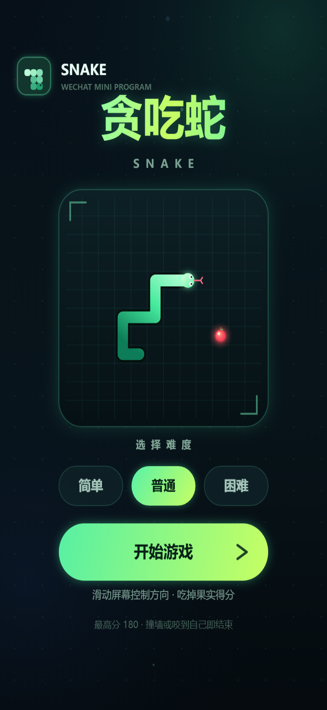
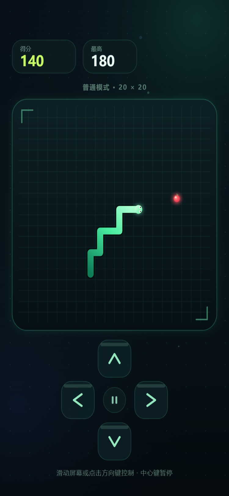
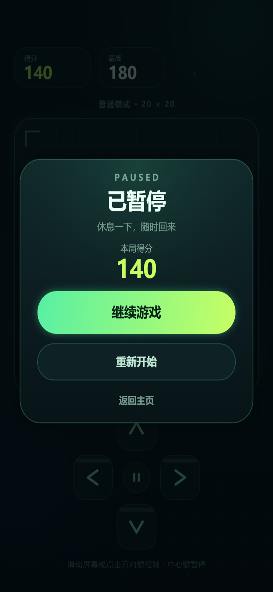
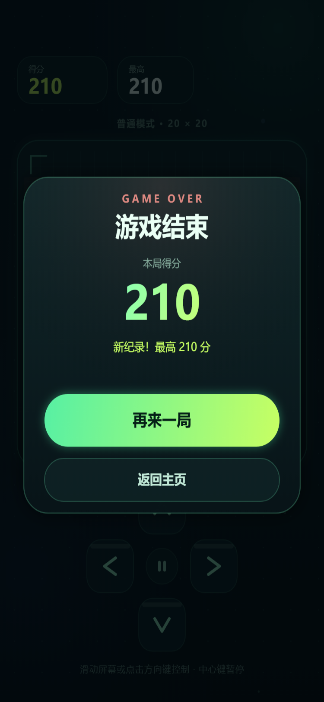
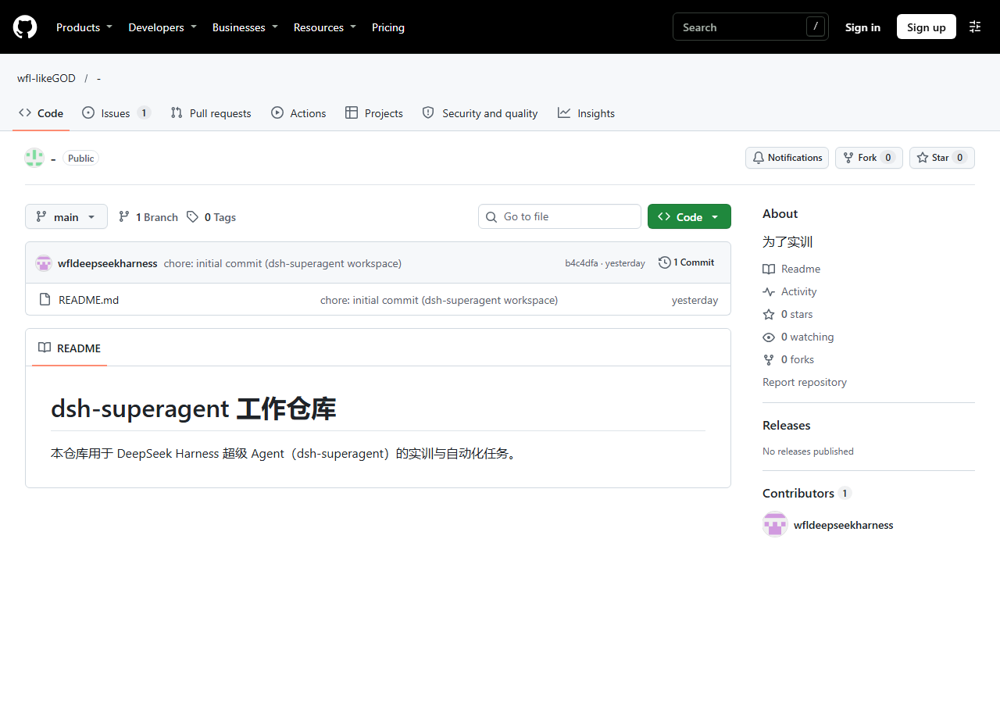

# 贪吃蛇 · 微信小程序

一个使用原生微信小程序（WXML / WXSS / Canvas 2D）实现的贪吃蛇小游戏：暗色霓虹视觉、三档难度、滑动或方向键操作、暂停、最高分本地持久化。

> 本仓库同时用于 dsh-superagent 的实训与自动化任务。本项目的全部逻辑不依赖后端与云开发，导入微信开发者工具即可运行。

## 预览

| 菜单 | 游戏中 | 暂停 | 结算 |
| --- | --- | --- | --- |
|  |  |  |  |

> 上图为 `preview/` 浏览器预览生成的画面，与小程序共用同一套 `core / controller / renderer` 代码。当前环境未安装微信开发者工具，因此未提供开发者工具内的截图；小程序的页面壳（Canvas 初始化、触摸事件、生命周期）已通过 Node 模拟环境测试。

## 功能

- 20 × 20 棋盘，简单 / 普通 / 困难三档难度，速度随吃到的果实数量逐步加快。
- 滑动屏幕或点击屏幕下方的方向键控制；转向队列最多缓存两步，禁止直接反向。
- 暂停 / 继续、重新开始、返回主页；切到后台时自动暂停。
- 最高分按难度保存在本地（`wx.setStorageSync`），破纪录时结算页显示“新纪录”。
- Canvas 2D 绘制：发光果实、蛇身渐变与眼睛、开场演示、毛玻璃弹窗、轻量背景动效。
- 吃到果实、游戏结束提供轻触震动反馈（`wx.vibrateShort`）。

## 运行

1. 安装 [微信开发者工具](https://developers.weixin.qq.com/miniprogram/dev/devtools/download.html)。
2. 选择“导入项目”，目录选择**本仓库根目录**（不是 `miniprogram/`），AppID 使用测试号或游客模式即可。`project.config.json` 中的 `miniprogramRoot` 已指向 `miniprogram/`。
3. 编译并在模拟器或真机预览中运行。

如果要使用自己的 AppID，把 `project.config.json` 中的 `appid` 替换掉即可。

## 操作

- 菜单：选择难度，点击“开始游戏”。
- 游戏中：滑动屏幕，或点击方向键；方向键中心可暂停。
- 暂停 / 结算：继续游戏、重新开始或返回主页。

## 浏览器预览

直接打开 `preview/index.html` 即可交互（支持鼠标滑动、点击与键盘方向键、空格暂停、回车开始）：

- 无参数：可交互预览，最高分保存在浏览器 `localStorage`。
- `?capture=menu|playing|paused|over`：渲染一张固定演示画面，便于截图与视觉回归。

预览与小程序使用同一套游戏逻辑和渲染代码，区别只在于宿主 API（浏览器 vs `wx`）。

## 目录结构

```text
project.config.json         微信开发者工具项目配置（miniprogramRoot: miniprogram/）
miniprogram/
  app.js / app.json / app.wxss / sitemap.json
  pages/index/              页面壳：Canvas 初始化、触摸、生命周期
  game/core.js              纯游戏逻辑：棋盘、蛇、食物、碰撞、难度、随机数
  game/controller.js        状态机：菜单/游戏中/暂停/结算、最高分持久化
  game/renderer.js          Canvas 渲染与可点击区域布局
preview/                    浏览器预览（开发与截图用）
tests/                      Node 内置测试
scripts/screenshot.mjs      生成 docs/screenshots 下的截图
docs/screenshots/           Before / After 视觉证据
```

## 测试

```bash
npm test
```

覆盖：

- 核心规则：移动、吃食物、撞墙、咬到自己、尾巴让位、反向限制、难度间隔、食物生成。
- 状态机：开始、暂停、继续、结算、最高分持久化、难度持久化、损坏存储回退。
- 渲染布局：常见与小屏尺寸下的棋盘、按钮、弹窗边界，以及四种场景的完整绘制冒烟测试。
- 页面壳：在模拟的 `wx` 环境中完成 Canvas 初始化、触摸开始游戏、切后台暂停与卸载清理。

生成截图（需要本机安装 Edge 或 Chrome，可用 `EDGE_PATH` 指定路径）：

```bash
npm run screenshots
```

## 设计说明

- 所有界面（HUD、棋盘、按钮、弹窗）都在同一块 2D Canvas 上绘制，避免 WXML 与 Canvas 混排带来的适配问题，也让浏览器预览与小程序视觉保持一致。
- 每帧由页面调用 `controller.update(delta)` 推进游戏状态机，再调用 `renderer.draw(...)` 绘制；暂停或切后台时停止推进逻辑，只保留渲染。
- 速度模型：`max(minInterval, baseInterval - eaten * speedUp)`，难度越高初始间隔越短。
- 本地存储键：最高分 `snake.best.v1`（按难度保存对象）；上次难度 `snake.difficulty.v1`。

## Before / After

**Before**：仓库初始状态只有 README，没有任何小程序代码或界面。



**After**：完整可运行的贪吃蛇小程序（上文四张画面）。
